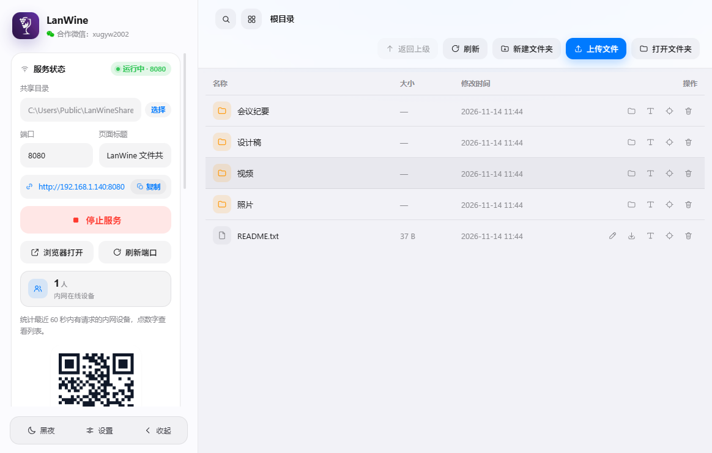
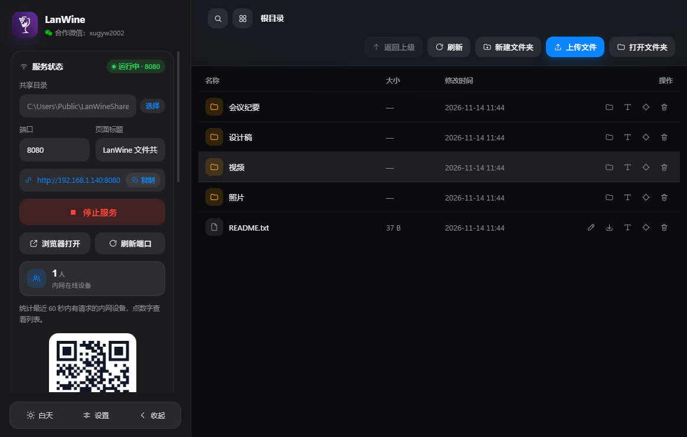
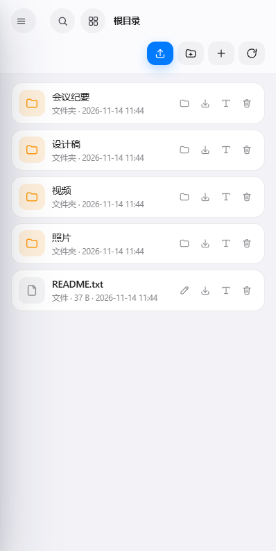
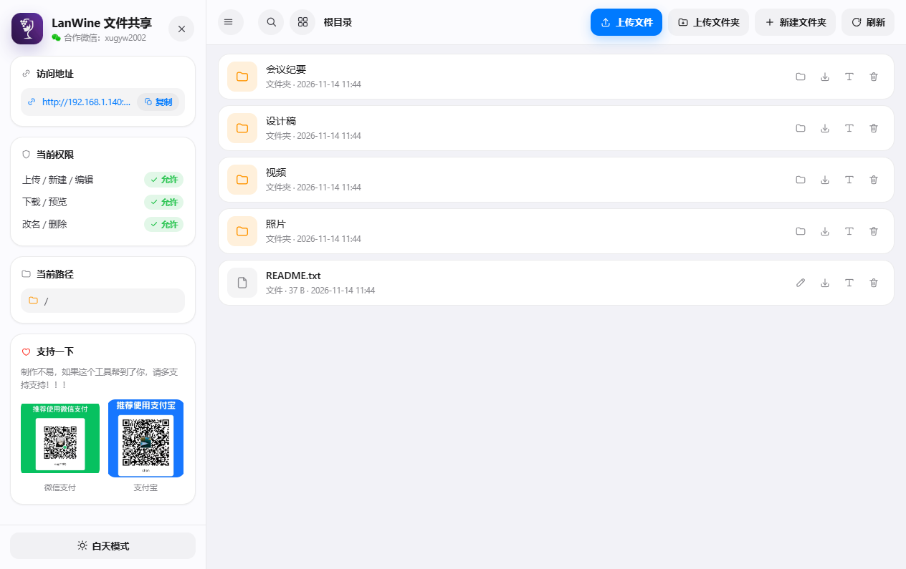

  

<h1 align="center">LanWine</h1>

  <b>把任意本地文件夹，一键变成一个可以扫码访问的局域网文件站</b> 
  Turn any local folder into a LAN file site your phone can open by scanning a QR code

  
  
  
  

  <a href="#中文">中文说明</a> · <a href="#english">English</a> · <a href="../../releases/latest">下载 Download</a>

> 本仓库仅提供**编译好的可执行文件**，不包含源代码。
> This repository only ships the **compiled executable**, no source code.

---

## 界面预览 / Screenshots

**桌面端 / Desktop**（浅色）

| 深色主题 / Dark | 手机端 / Mobile |
| --- | --- |
|  |  |

**网页端 / Web（电脑浏览器）**

---

<h1 id="中文">中文说明</h1>

Windows 桌面端小工具：选一个文件夹 → 点「启动服务」→ 同一 Wi-Fi 下的手机、平板、电脑用浏览器打开地址或扫码，就能浏览、上传、下载、改名、删除、在线预览和编辑。对方设备**不需要安装任何程序**。需要外出访问时，可一键开启内网穿透，拿到一个公网 https 地址和二维码。

### 下载

前往 [Releases](../../releases/latest) 页面下载：

| 文件 | 大小 | 说明 |
| --- | --- | --- |
| `LanWine-1.0.0.exe` | 约 102 MB | 免安装单文件版，双击即用，不需要安装、不依赖任何运行库 |

系统要求：**Windows 10 / 11（64 位）**。程序已自带运行时，无需另外安装 .NET、Node.js 或运行库。

### 快速开始

1. 双击 `LanWine-1.0.0.exe`（首次启动约 10 秒，见[常见问题](#常见问题)）。
2. 在左侧「共享目录」点「选择」，选中要共享的文件夹。
3. 点「启动服务」，弹出的 Windows 防火墙提示请选择**允许访问**。
4. 把左侧显示的地址发给同一局域网的人，或用手机扫描二维码打开。

### 功能特性

**文件管理**
- 浏览目录、上传文件、**上传整个文件夹**、拖拽上传
- 下载文件、**文件夹打包成 ZIP 下载**
- 新建文件夹、重命名、删除

**在线预览与编辑**
- 图片 / 视频 / 音频直接在浏览器播放（支持拖动进度条）
- PDF 在线查看
- Office 文档预览：Word（.docx）、Excel（.xlsx / .xls / .csv）、PowerPoint（.pptx，含幻灯片文字与图片）
- 文本文件在线编辑并保存回原文件

**分享与权限**
- 二维码扫码访问，地址一键复制
- 三个独立权限开关：允许上传 / 新建 / 编辑、允许下载 / 预览、允许改名 / 删除，改动**立即生效**
- 可选访问密码（HTTP Basic 认证），适合半公开场景

**外网访问**
- 一键内网穿透（Cloudflare 快速隧道），无需注册账号即可获得 `https://xxx.trycloudflare.com` 公网地址与二维码
- 组件首次使用时自动下载，关闭即断开

**其他**
- 访问统计：实时显示内网 / 外网在线设备数，可查看 IP、设备类型、首次与最近访问时间、请求次数
- 黑名单：一键拉黑某台设备，内网与外网分开管理
- 操作记录：上传、下载、改名、删除等操作留痕（保留最近 500 条，重启清空）
- 深色 / 浅色主题、中文 / 英文界面切换
- 侧边栏可折叠，列表 / 图标网格两种视图

### 权限说明

| 开关 | 控制范围 |
| --- | --- |
| 允许上传 / 新建 / 编辑 | 上传文件、新建文件夹、在线编辑保存文本 |
| 允许下载 / 预览 | 下载、打包下载、图片 / 视频 / 音频 / 文档预览 |
| 允许改名 / 删除 | 重命名与删除 |

开关修改后立即保存并对已连接的设备生效，对方刷新页面即可同步。

### 使用建议与安全提示

- 本工具面向**可信的局域网环境**（家庭、办公室、临时协作）。
- 一旦开启「内网穿透」，**请务必同时开启访问密码**，否则任何拿到公网地址的人都能读写你的共享目录。
- 共享目录只选择你愿意公开的文件夹，不要把整个系统盘或包含敏感资料的目录共享出去。
- 结束共享后及时点「停止服务」或关闭软件。

### 常见问题

**打开时提示「Windows 已保护你的电脑」？**
程序未购买代码签名证书，属正常现象。点「更多信息」→「仍要运行」即可。

**首次启动等了几秒才出现窗口？**
单文件免安装版每次启动都需要把内置的运行环境解压到临时目录，约 10 秒属于正常表现。如需更快启动，可改用安装版（如已提供），装好后启动约 1 秒。

**手机 / 其他电脑打不开地址？**
1. 确认两台设备连的是**同一个 Wi-Fi / 同一局域网**；
2. 确认已点「启动服务」，且 Windows 防火墙允许了 LanWine 的专用网络访问；
3. 公司或酒店网络可能开启了「客户端隔离」，会阻止设备互访，请换网络测试。

**提示端口被占用？**
换一个端口（如 8090、9000）即可，程序会在运行中自动切换；若新端口仍不可用，会自动回退到原端口并保持服务在线。也可用「刷新端口」按钮自动换一个空闲端口。

**公网地址 `*.trycloudflare.com` 打不开？**
该域名在部分地区会被 DNS 污染或屏蔽，可尝试更换网络或使用代理；局域网访问不受影响。

**配置保存在哪里？**
配置、黑名单、内网穿透组件都在 `%APPDATA%\LanWine` 目录下，删除该目录即可彻底重置（便携版程序本身不写注册表，卸载只需删掉 exe）。

**软件收费吗？**
个人使用免费。如果它帮到了你，欢迎在软件内「支持一下」。

### 更新日志

**v1.0.0**
- 首个发布版本
- 局域网文件站、二维码访问、权限开关、访问密码
- 图片 / 视频 / 音频 / PDF / Office 在线预览，文本在线编辑
- 内网穿透（外网访问）、访问统计、黑名单、操作记录
- 深色主题、中英文界面

### 反馈

使用中遇到问题或有功能建议，欢迎通过 [Issues](../../issues) 反馈，也可以联系作者微信：**xugyw2002**。
反馈时建议附上：Windows 版本、是否使用内网穿透、出错时的提示文字或截图。

---

<h1 id="english">English</h1>

LanWine is a small Windows desktop app that serves a folder over HTTP on your local network. Pick a folder, hit **Start**, and any phone, tablet or computer on the same Wi-Fi can open it in a browser — no client software required on the other side. When you need access from outside, one click starts a Cloudflare quick tunnel and gives you a public HTTPS URL plus a QR code.

### Download

Get it from the [Releases](../../releases/latest) page:

| File | Size | Notes |
| --- | --- | --- |
| `LanWine-1.0.0.exe` | ~102 MB | Portable single executable. No installer, no runtime dependencies. |

**Requires Windows 10 / 11 (64-bit).** Everything needed is bundled — no .NET, Node.js or Visual C++ runtime to install.

### Quick start

1. Double-click `LanWine-1.0.0.exe` (the first launch takes ~10 seconds, see [FAQ](#faq)).
2. Click **Choose** next to "Shared folder" and pick the folder you want to share.
3. Click **Start Service**. When Windows Firewall asks, choose **Allow**.
4. Share the URL shown on the left, or let others scan the QR code with their phone.

### Features

**File management** — browse folders, upload files or entire folders (drag & drop supported), download files, download a folder as ZIP, create folders, rename and delete.

**Preview & editing** — images, video and audio play directly in the browser (seeking supported); PDFs open inline; Office documents can be previewed (Word `.docx`, Excel `.xlsx / .xls / .csv`, PowerPoint `.pptx` including slide text and pictures); text files can be edited and saved back in place.

**Sharing & permissions** — QR code access and one-click copy of the URL; three independent permission switches (upload / create / edit, download / preview, rename / delete) that take effect immediately; optional password protection (HTTP Basic auth).

**Remote access** — one-click Cloudflare quick tunnel; no account needed. You get a `https://xxx.trycloudflare.com` address plus a QR code. The tunnel component downloads itself on first use and closes with the app.

**Extras** — live LAN / WAN visitor counters with IP, device type, first / last seen and hit count; per-IP blocklist (LAN and WAN managed separately); activity log of uploads, downloads, renames and deletes (last 500 entries, cleared on exit); dark / light theme; Chinese / English UI; collapsible sidebar; list and grid views.

### Notes & safety

- Designed for **trusted local networks** (home, office, temporary collaboration).
- If you enable the tunnel, **always turn on the access password** — otherwise anyone with the public URL can read and write your shared folder.
- Only share folders you are comfortable exposing. Never share an entire system drive.
- Stop the service when you are done.

### FAQ

**"Windows protected your PC" on launch?**
The executable is not code-signed. Click **More info → Run anyway**.

**Why does the first launch take a few seconds?**
The portable single-file build unpacks its bundled runtime to a temporary folder on every start (~10 s). If you prefer instant startup, use the installer build (when provided), which starts in about 1 second once installed.

**The URL does not open on my phone.**
Make sure both devices are on the same Wi-Fi / LAN, that the service is started, and that Windows Firewall allows LanWine on private networks. Guest or corporate Wi-Fi with "client isolation" will block device-to-device access — try another network.

**"Port already in use"?**
Pick another port (e.g. 8090 or 9000); the service restarts automatically while running. If the new port is also unavailable, LanWine falls back to the previous port and keeps the service online. The **Refresh Port** button picks a free port for you.

**The `*.trycloudflare.com` address does not load.**
That domain is DNS-poisoned or blocked in some regions. Try another network or a proxy — local access is unaffected.

**Where are settings stored?**
In `%APPDATA%\LanWine` (settings, blocklist, tunnel component). Delete that folder to reset. The portable build writes nothing to the registry — uninstalling is just deleting the exe.

**Is it free?**
Free for personal use. If it helps you, feel free to use the "Support" card inside the app.

### Feedback

Bug reports and feature requests are welcome via [Issues](../../issues), or contact the author on WeChat: **xugyw2002**. Please include your Windows version, whether the tunnel was enabled, and any error message or screenshot.

---

本仓库仅分发成品软件，不提供源代码，也不提供二次开发支持。软件按「现状」提供，请在符合当地法律法规与组织规定的前提下使用。 
This repository only distributes the compiled application. No source code is provided and no development support is offered. The software is provided "as is"; you are responsible for how you use it and for the data you share.

